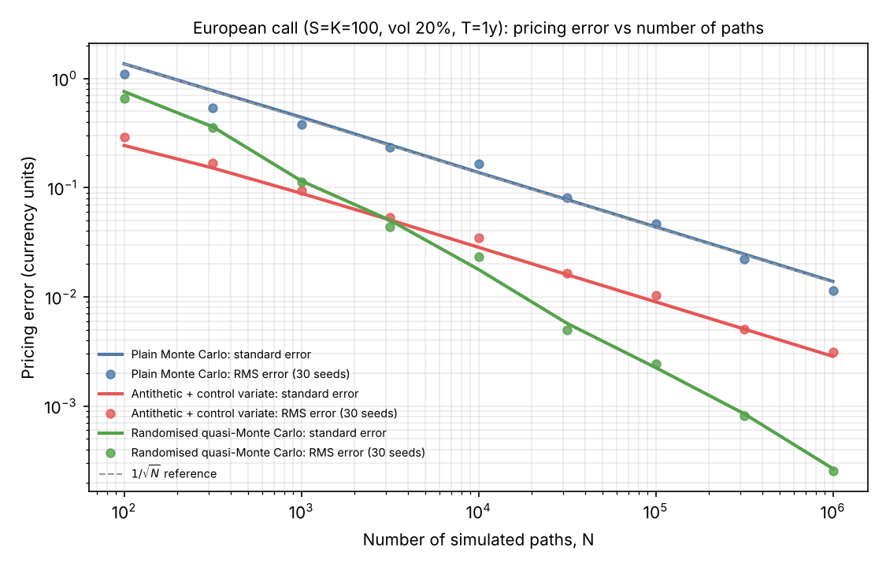

# Derivatives Pricing Library in C++17

A header-only C++17 library for pricing equity, FX and interest-rate derivatives. Every model is priced at least two independent ways, and each method is checked against the other.

| Module | What it prices | Checked against |
|---|---|---|
| `black_scholes.hpp` | European options: price, 5 Greeks, implied vol | Hull textbook values, put–call parity, finite differences |
| `monte_carlo.hpp` | European and arithmetic Asian options by simulation, pathwise Greeks | Exact Black–Scholes and geometric Asian formulas |
| `american.hpp` | American options: binomial tree and Longstaff–Schwartz | Each other, and Longstaff & Schwartz (2001), Table 1 |
| `hull_white.hpp` | Zero-coupon bonds, bond options, caplets, caps; vol calibration | Closed forms vs exact simulation; fit to the initial curve |
| `parallel.hpp` | Multi-threaded Monte Carlo, randomised quasi-Monte Carlo | Single-threaded results; merge exactness |

Every Monte Carlo estimate reports its standard error and 95% confidence interval. The 160-check test suite runs in about 2 seconds. Only the standard library is used; Python is used just to draw the chart.

**FX options are already covered.** The Garman–Kohlhagen model is Black–Scholes with the dividend yield q set to the foreign interest rate. For example, a EUR/USD call uses q = the EUR rate.

## Results

All figures come from `./build/pricer` (saved in [`results/demo_output.txt`](results/demo_output.txt)), run on a 2-core cloud VM.

### 1. Variance reduction on a European call

S = K = 100, r = 5%, q = 2%, σ = 20%, T = 1. The exact Black–Scholes price is **9.22701**.

| Method (1,000,000 paths) | Price | Std. error | Variance reduction |
|---|---|---|---|
| Plain Monte Carlo | 9.24734 | 0.01386 | 1× |
| Antithetic variates | 9.22614 | 0.01033 | 1.8× |
| Control variate (discounted S_T) | 9.22630 | 0.00569 | 5.9× |
| Antithetic + control variate | 9.22015 | 0.00286 | 23.6× |

Over 200 independent seeds, the combined estimator's mean error is 0.0003 ± 0.0005, so it shows no bias. Its RMS error (0.0066) matches its reported standard error (0.0064). Pathwise Monte Carlo Greeks land within one standard error of the exact values:

- Delta: 0.58676 ± 0.00015 against 0.58685 exact.
- Vega: 37.862 ± 0.063 against 37.901 exact.

### 2. Arithmetic Asian option (no closed form)

The option has 252 daily fixings and is priced with 100,000 paths. The arithmetic and geometric payoffs have a correlation of 0.9996. Using the exactly priceable geometric Asian as a control variate cuts the standard error from 0.0241 to 0.0007, a **1,367×** variance reduction. The price is 5.1958 ± 0.0007.

### 3. American put: two methods vs the published benchmark

K = 40, r = 6%. The LSM column uses 100,000 paths with 50 exercise dates a year.

| S | σ | T | European | Binomial (5,000 steps) | LSM | Paper FD | Paper LSM |
|---|---|---|---|---|---|---|---|
| 36 | 0.2 | 1 | 3.8443 | 4.4867 | 4.4675 ± 0.0060 | 4.478 | 4.472 |
| 36 | 0.4 | 2 | 7.7000 | 8.5144 | 8.4762 ± 0.0103 | 8.508 | 8.488 |
| 40 | 0.2 | 1 | 2.0664 | 2.3195 | 2.3173 ± 0.0053 | 2.314 | 2.313 |
| 44 | 0.2 | 1 | 1.0169 | 1.1130 | 1.1120 ± 0.0055 | 1.110 | 1.118 |

The paper is Longstaff & Schwartz (2001), *Valuing American Options by Simulation*, Table 1.

LSM sits slightly below the binomial tree in every row, and that is expected for two reasons:

- It prices a Bermudan option, which can only be exercised on 50 dates a year.
- It applies an estimated exercise rule to fresh paths. Any suboptimal rule gives a lower bound in expectation.

As a further check, an American call on a non-dividend stock comes out at the European price, 10.45018 against 10.45058. Theory says such a call should never be exercised early.

### 4. Hull–White interest-rate model

Parameters: a = 0.05, σ = 1%. The model is fitted to an illustrative Nelson–Siegel curve, not live market data.

- **Zero-coupon bonds:** the simulated values reproduce the input curve at 1, 5, 10 and 30 years, all within 1.3 standard errors.
- **Caplets:** for the 3-month rate fixing in 4.75 years (forward 4.191%), Monte Carlo matches the closed form at strikes of 3%, 4% and 5%. Antithetic variates plus a bond control variate cut variance 2.6–12.7×.
- **Cap:** a 10-year quarterly cap struck at 4% is worth 0.06199 per unit notional.
- **Calibration:** σ is recovered from that cap price to 1e-8.

### 5. Speed

| Threads | Time (20M paths) | Throughput | Speed-up |
|---|---|---|---|
| 1 | 712 ms | 28.1 M paths/s | 1.00× |
| 2 | 413 ms | 48.4 M paths/s | 1.72× |

Only 2 cores were available. Run `./build/pricer benchmark` to measure your own machine.



Plain and variance-reduced Monte Carlo both converge at the 1/√N rate; the fitted log–log slopes are −0.48 and −0.50. Randomised quasi-Monte Carlo converges at a slope of **−0.86**. At one million paths its RMS error is 0.00025, against 0.0115 for plain Monte Carlo: about 45× more accurate. Each dot is the RMS error over 30 seeds, and it sits on the method's reported standard error, so the error bars can be trusted.

## Build and run

```bash
cmake -S . -B build -DCMAKE_BUILD_TYPE=Release
cmake --build build
./build/pricer_tests                                    # 160 checks
./build/pricer                                          # full report
./build/pricer price    42 40 0.10 0 0.20 0.5 call      # S K r q vol T call|put [paths]
./build/pricer american 36 40 0.06 0 0.20 1   put
./build/pricer benchmark
./build/pricer convergence results/convergence.csv
python3 scripts/plot_convergence.py results/convergence.csv results/convergence.png
```

## How it works

### Black–Scholes

With d1 = [ln(S/K) + (r − q + σ²/2)T] / σ√T and d2 = d1 − σ√T, the call price is S e^{−qT} N(d1) − K e^{−rT} N(d2). N(x) comes from `std::erfc`, which stays accurate in the tails.

Implied volatility uses Newton–Raphson on vega. Whenever a Newton step would leave the current bracket, it falls back to bisection, so it always converges.

### Monte Carlo

The underlying follows S_T = S₀ exp[(r − q − σ²/2)T + σ√T Z]. This step is exact, so a European option needs only one draw per path.

- **Antithetic variates** pair each draw Z with −Z. For a monotonic payoff the two results are negatively correlated, so their average has lower variance.
- **Control variates.** The estimator Y − b(X − E[X]) with b = Cov(Y, X)/Var(X) has variance Var(Y)(1 − ρ²).
  - For European options, X = e^{−rT} S_T, whose expectation is exactly S₀ e^{−qT}.
  - For Asian options, X is the geometric-average payoff, which has a closed form because the log of a geometric average of lognormals is normal.
- **Statistics** are accumulated in a single pass with Welford's algorithm.
- **Pathwise Greeks** differentiate the payoff inside the expectation. For a call, delta = E[e^{−rT} 1{S_T > K} S_T/S₀]. Gamma can't be computed pathwise because delta's payoff is discontinuous at the strike. It is a central difference of pathwise delta instead, with common random numbers so most of the noise cancels.

### American options

**Binomial tree (Cox–Ross–Rubinstein):** up = e^{σ√Δt}, down = 1/up, and risk-neutral probability p = (e^{(r−q)Δt} − down)/(up − down). Working backwards, each node takes max(continuation, exercise). The method takes O(n²) time and O(n) memory.

**Longstaff–Schwartz:**
1. Simulate paths on the exercise dates.
2. Working backwards, regress the discounted future cash flow on the polynomials 1, x, x², x³, where x = S/K. Only in-the-money paths are used.
3. Exercise wherever the immediate payoff beats the fitted continuation value.

The exercise rule is fitted on one set of paths and priced on a second, independent set, so the estimate is a lower bound in expectation. The fit-set price is also reported for comparison.

### Hull–White

The short rate is r(t) = x(t) + φ(t), where dx = −a x dt + σ dW. φ is chosen so that the model reproduces today's discount curve P(0, T) exactly (Brigo & Mercurio, ch. 3.3).

Because x is Gaussian:
- Bond prices are P(t, T) = P(0, T)/P(0, t) · exp(½[V(t, T) − V(0, T) + V(0, t)] − B(t, T) x(t)).
- Bond options have Black-type closed forms.
- A caplet equals (1 + Kτ) puts on a zero-coupon bond.

The simulation draws x(T) and ∫x together from their exact bivariate normal distribution in one step, so there is no time-stepping error. Calibration finds σ by bisection on the cap price, which increases with σ.

### Speed

- **Threads:** each thread runs its own Mersenne Twister stream seeded via `std::seed_seq`, and keeps its own statistics. The results are merged exactly with the Chan–Golub–LeVeque formulas. There are no locks, and results are reproducible for a given seed and thread count.
- **Quasi-Monte Carlo:** uses the van der Corput sequence (identical to the 1-D Sobol sequence), mapped to normals by Acklam's inverse CDF plus one Halley refinement step, accurate to 1e-14. It is randomised with Cranley–Patterson shifts. Each shift gives an unbiased estimate, and the spread across shifts gives a real standard error.

## Validation

The 160 checks in [`tests/test_pricer.cpp`](tests/test_pricer.cpp) cover:

- Textbook reference prices.
- Put–call parity for European options (to 1e-10) and for bond options (to 1e-14).
- Every analytic Greek against finite differences.
- Implied-vol round trips.
- Every Monte Carlo variant within 4 standard errors of the exact price.
- 1/√N scaling of the standard error.
- The binomial tree converging to Black–Scholes.
- American call = European call without dividends, and deep in-the-money American put = intrinsic value.
- The Longstaff & Schwartz (2001) benchmark, and LSM against the binomial tree.
- The Hull–White fit to the curve, simulated caplets against the closed form, and calibration round trips.
- Thread-merge exactness and reproducibility.
- The inverse normal CDF to 1e-14, and quasi-Monte Carlo beating plain Monte Carlo.

## Limitations

- **The yield curve is illustrative.** In production, the Hull–White curve would be bootstrapped from OIS swap quotes.
- **One-factor Hull–White can't match the whole volatility surface.** Its rates are also Gaussian, so they can go negative.
- **Quasi-Monte Carlo is one-dimensional.** Path-dependent products need multi-dimensional Sobol direction numbers (Joe–Kuo) and a Brownian-bridge construction.
- **The LSM exercise rule is only as good as its polynomial regression.** The basis is plain polynomials 1, x, x², x³.

## Possible extensions

- Multi-dimensional Sobol with a Brownian bridge.
- Heston stochastic volatility.
- Swaptions under Hull–White, using Jamshidian's decomposition.
- An OIS curve bootstrap.
- Python bindings with pybind11.

## How this was built

Built with AI pair-programming (Claude). I set the scope, checked every result against published benchmarks and closed-form prices, and can explain every component.
